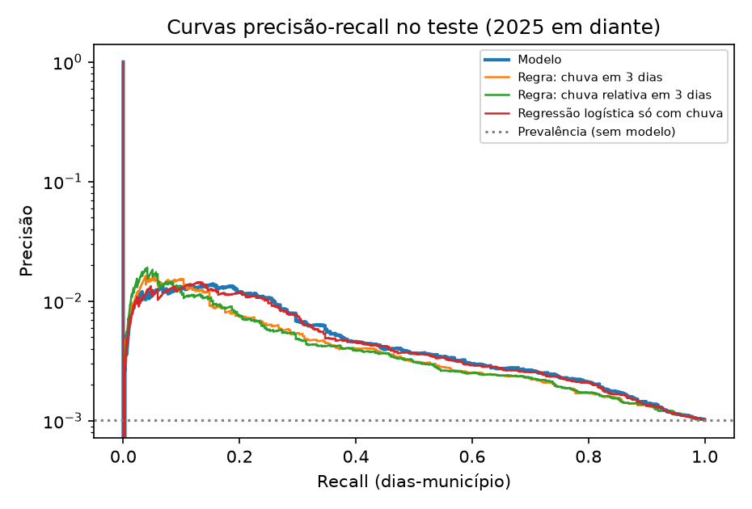
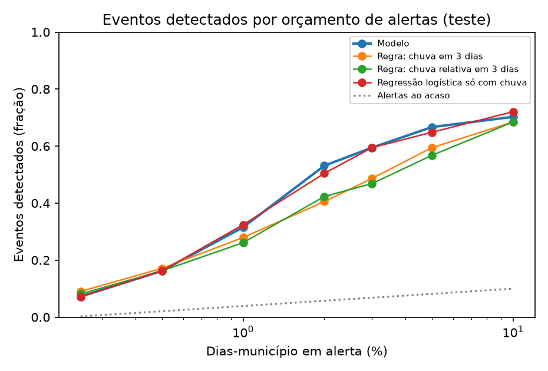
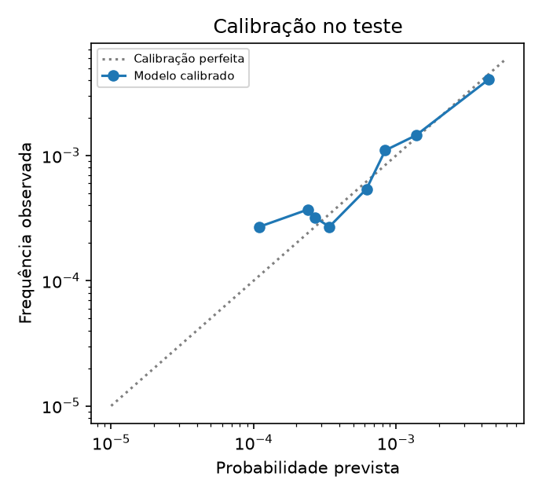
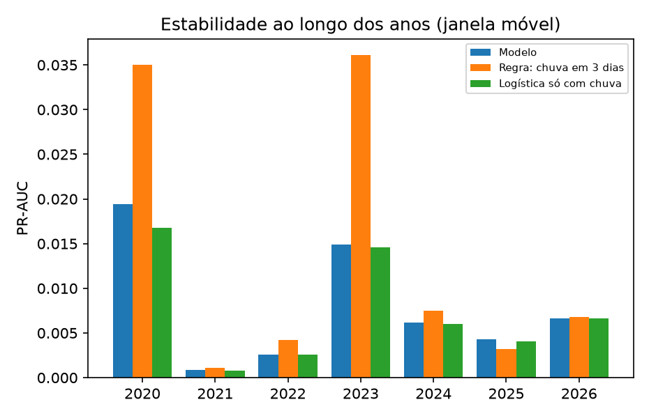
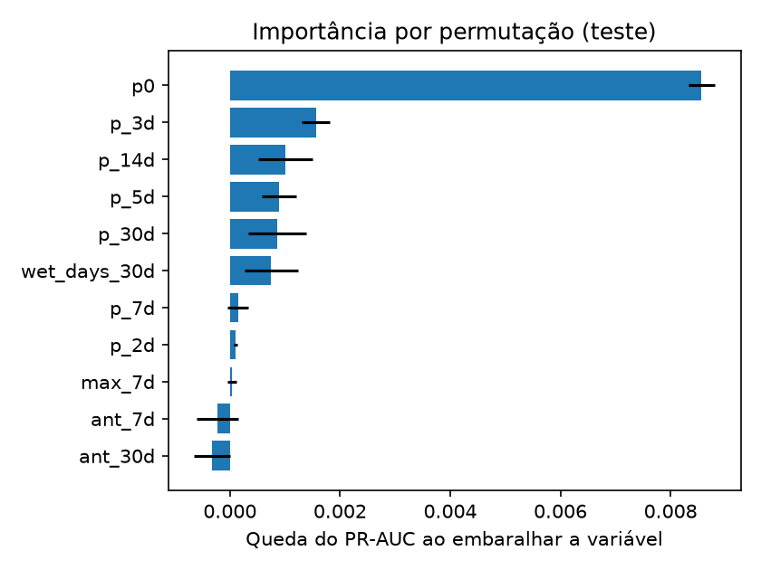

# Gatilho municipal de risco hídrico: dados, método e resultados (estrito)

_Documento gerado por `python -m flooding_mapping.evaluation.report`. Os números vêm de `reports/ml/gatilho_estrito.json`; nenhum foi digitado à mão._

## Resumo

- **Gatilho em uso:** regra de chuva (chuva relativa ao percentil 95 local em 3 dias), calibrada em frequência.
- **Modelo de aprendizado de máquina:** experimental: não passa em margem de PR-AUC na validação; anos da janela móvel vencidos; eventos detectados fora da amostra no mesmo orçamento de alertas.
- **Pergunta:** dado o cenário de chuva, qual município tem mais chance de **registrar um desastre hídrico** (inundação, enxurrada ou alagamento) naquele dia? Não prevê profundidade, extensão nem duração da água.
- **Dados:** 1.768.598 dias-município de 497 municípios (2017-01-31 a 2026-11-02), 2.238 dias positivos em 99 episódios, prevalência 0,13%.
- **Teste do modelo (2025 em diante; ver a seção 8 sobre seu uso):** PR-AUC 0,0056 contra prevalência 0,0010; ROC-AUC 0,773.
- Com o mesmo número de dias em alerta no teste (2%), o modelo de aprendizado de máquina detecta 59 dos 111 eventos (53%), a logística só com chuva 56, a regra de chuva relativa 47 e a regra de chuva em 3 dias 45. Antes do teste (janela móvel de 2020–2024, mesmo orçamento) a ordem foi a inversa: a melhor regra detectou 59% dos eventos e o modelo 48%. São diferenças de poucas dezenas de eventos, agrupados em poucos episódios, que não permitem afirmar que um supera o outro.
- **Gatilho em uso, no teste:** com os limiares fixados em 2020–2024 (orçamento de 2%), que no teste alertaram em 1,7% dos dias-município, detecta 43 dos 111 eventos (39%), com precisão de 0,95% (piso).
- **Artefato do gatilho:** `gatilho-estrito-20261109`, ajustado com dados de 2017-01-31 a 2026-11-02; SHA-256 `71196b91f4e8cea6…` (o artefato fica fora do git).

## 1. Dados (template 3.1)

| Fonte | Conteúdo | Uso | Acesso e restrições |
|---|---|---|---|
| S2iD (MIDR) | Registros de desastre por município (COBRADE, data, situação, danos) | Rótulo (variável-alvo) | CSV exportado manualmente do portal; CC-BY; 2017–2026 |
| Open-Meteo, arquivo (ERA5) | Precipitação diária por município | Variáveis de chuva | API pública gratuita (uso não comercial); CC BY 4.0 |
| Open-Meteo, previsão | Chuva dos últimos 40 dias e dos próximos 3 | Operação (72 h) | API pública |
| IBGE, Censo 2022 | Municípios, área, população | Variáveis territoriais | Aberto |
| DAER (SRE-RS) | Malha rodoviária, VDM, IRI | Impacto e suscetibilidade | Camada ArcGIS pública e planilha; licença a confirmar |
| CPRv BM | Bloqueios rodoviários ativos | Observação e rótulos futuros | API pública, sem histórico (coletor próprio) |


Os dados brutos não são versionados (procedência e hash em `data/raw/manifest.json`). Dados derivados pequenos (camadas do mapa, rankings de impacto, cartões dos modelos) ficam no repositório. O dataset do gatilho é gerado por `make estado-modelo`; a publicação em Zenodo ou Hugging Face depende da confirmação das licenças.

## 2. ETL e engenharia de dados (template 3.2)

1. **Coleta:** `ingestion/` (S2iD, DAER, Open-Meteo, municípios), com cache em disco, retomada e respeito aos limites da API.
2. **Organização:** uma linha por município e dia (`datasets/gatilho.py`).
3. **Limpeza:** protocolos do S2iD fora do padrão são erro explícito; duplicatas por protocolo removidas; janelas de chuva incompletas viram NaN e a linha é descartada, nunca preenchida.
4. **Rótulo:** `y = 1` nos 3 dias que terminam na data do protocolo; os 3 dias seguintes são excluídos (a água ainda está lá). Os demais dias são negativos **não rotulados**: município sem registro não é município sem alagamento, então a precisão é um piso.
5. **Variáveis** (`features/weather.py`): chuva no dia e acumulada em 2, 3, 5, 7, 14 e 30 dias; chuva dos 7 e 30 dias anteriores; máximo diário em 7 dias; dias úmidos em 30; chuva relativa ao percentil 95 do próprio município (climatologia 2017–2019); contexto regional (média e máximo da região imediata e fração do estado com ≥50 mm em 3 dias); sazonalidade; altitude, área e população. **Nenhuma variável do dia `d` usa chuva posterior a `d`** (testado).
6. **EDA** (759 registros): o protocolo coincide com o dia da chuva. Mediana de chuva de 29,9 mm no dia do protocolo, 15,4 mm no dia anterior e 2,8 mm no seguinte; 60% dos registros têm ≥20 mm no dia, contra 7,4% em dias aleatórios. A chuva forte é comum e o registro é raro, por isso o PR-AUC é baixo mesmo com sinal real.

| Ano | Dias positivos |
|---|---|
| 2017 | 574 |
| 2018 | 73 |
| 2019 | 159 |
| 2020 | 111 |
| 2021 | 69 |
| 2022 | 93 |
| 2023 | 620 |
| 2024 | 202 |
| 2025 | 155 |
| 2026 | 182 |


## 3. Seleção do modelo (template 3.3)

Dados tabulares, relação não linear e extremamente desbalanceada: comparam-se regressão logística (referência interpretável), floresta aleatória e gradiente de árvores (`HistGradientBoosting`), todos contra três baselines simples (acaso, regra de chuva em 3 dias, regra de chuva relativa) e uma logística só com chuva. Não há série temporal no modelo: a dinâmica entra pelas janelas de chuva acumulada. Redes neurais não foram usadas porque {thousands(d['positivos'])} dias positivos agrupados em 99 episódios não sustentam um modelo mais flexível; seria sobreajuste.

**Escolha:** logistica {"C": 0.01}, a família mais simples dentro de 10% (relativo) do melhor PR-AUC de validação. **Estado:** experimental: não passa em margem de PR-AUC na validação; anos da janela móvel vencidos; eventos detectados fora da amostra no mesmo orçamento de alertas.

O selo "validado" exige três critérios independentes, todos medidos antes do teste:

| Critério | Passa | Detalhe |
|---|---|---|
| margem de PR-AUC na validação | **não** | 0.0099 contra 0.0201 (margem 10%) |
| anos da janela móvel vencidos | **não** | 0 de 5 anos (mínimo 60%) |
| eventos detectados fora da amostra no mesmo orçamento de alertas | **não** | modelo 0.481 contra melhor baseline 0.586 com 2% dos dias em alerta |

## 4. Treinamento (template 3.4)

Semente 20261108; ambiente: Python 3.12.13, scikit-learn 1.9.1, numpy 2.5.4, pandas 3.1.0. Treina-se com todos os positivos e 50 negativos aleatórios por positivo (velocidade e equilíbrio); a avaliação usa todas as linhas, com a prevalência natural, e a calibração isotônica devolve as probabilidades a essa escala. Sem épocas, batch ou taxa de aprendizado além dos hiperparâmetros abaixo (gradiente de árvores: 300 iterações, regularização L2 = 1).

**Partições temporais** (com expurgo de 7 dias nas fronteiras):

| Partição | Linhas | Positivos | Período |
|---|---|---|---|
| train | 1.069.465 | 1079 | 2017-01-31 a 2022-12-24 |
| val | 359.018 | 822 | 2023-01-01 a 2024-12-24 |
| test | 333.157 | 337 | 2025-01-01 a 2026-11-02 |


Episódios com positivos em mais de uma partição: **0**.

**Hiperparâmetros testados** (ajustados só na validação, 2023–2024):

| Família | Parâmetros | PR-AUC val. | ROC-AUC val. |
|---|---|---|---|
| logistica | {"C": 0.01} | 0,0099 | 0,8152 |
| logistica | {"C": 0.1} | 0,0097 | 0,8150 |
| logistica | {"C": 1.0} | 0,0097 | 0,8148 |
| hgb | {"learning_rate": 0.05, "max_depth": 3, "min_samples_leaf": 100} | 0,0104 | 0,8231 |
| hgb | {"learning_rate": 0.05, "max_depth": 5, "min_samples_leaf": 100} | 0,0106 | 0,8228 |
| hgb | {"learning_rate": 0.1, "max_depth": 3, "min_samples_leaf": 100} | 0,0108 | 0,8235 |
| hgb | {"learning_rate": 0.1, "max_depth": 5, "min_samples_leaf": 100} | 0,0108 | 0,8246 |
| rf | {"min_samples_leaf": 20} | 0,0084 | 0,8146 |
| rf | {"min_samples_leaf": 100} | 0,0087 | 0,8138 |


**Seleção de variáveis** (ablação com um modelo fixo, validação):

| Conjunto | Variáveis | PR-AUC | ROC-AUC |
|---|---|---|---|
| chuva | 11 | 0,0108 | 0,8246 |
| chuva+estacao | 13 | 0,0076 | 0,7666 |
| chuva+relativa | 13 | 0,0108 | 0,8243 |
| chuva+regional | 17 | 0,0114 | 0,8327 |
| completo | 24 | 0,0079 | 0,7740 |


Escolhido: **chuva** (11 variáveis).

## 5. Validação cruzada (template 3.5)

A validação respeita o tempo e os episódios: (a) partição temporal fixa; (b) **janela móvel** (treina no passado e prevê um ano, 2020–2026), cujos resultados de 2020–2024 calibram o modelo e fixam os limiares, e os de 2025–2026 só são reportados; (c) **generalização espacial**: treina em quatro quintos dos municípios (antes de 2023) e testa nos demais (2025 em diante).

| Ano | Positivos | PR-AUC modelo | PR-AUC regra 3 dias | PR-AUC logística |
|---|---|---|---|---|
| 2020 | 111 | 0,0194 | 0,0350 | 0,0168 |
| 2021 | 69 | 0,0009 | 0,0011 | 0,0008 |
| 2022 | 93 | 0,0026 | 0,0042 | 0,0026 |
| 2023 | 620 | 0,0149 | 0,0361 | 0,0146 |
| 2024 | 202 | 0,0062 | 0,0075 | 0,0060 |
| 2025 | 155 | 0,0043 | 0,0032 | 0,0041 |
| 2026 | 182 | 0,0066 | 0,0068 | 0,0066 |


| Região fora do treino | Municípios | Positivos | PR-AUC modelo | PR-AUC regra 3 dias |
|---|---|---|---|---|
| 0 | 103 | 24 | 0,0041 | 0,0027 |
| 1 | 156 | 129 | 0,0070 | 0,0080 |
| 2 | 36 | 54 | 0,0169 | 0,0090 |
| 3 | 53 | 68 | 0,0070 | 0,0068 |
| 4 | 149 | 62 | 0,0031 | 0,0040 |


## 6. Avaliação (template 3.6)

Matriz de confusão e demais métricas **do modelo de aprendizado de máquina (experimental)** por orçamento de alertas (limiares fixados em 2020–2024, aplicados ao teste). Acurácia não é reportada: com prevalência de 0,10%, um modelo que nunca alerta acerta mais de 99%.

| Orçamento | VP | FP | FN | VN | Precisão | Recall (dias) | F1 | Alertas por mil dias | Eventos detectados |
|---|---|---|---|---|---|---|---|---|---|
| 0,5% dos dias | 0 | 11 | 337 | 332.809 | 0,00% | 0,0% | 0,0000 | 0,0 | 0/111 |
| 2% dos dias | 11 | 984 | 326 | 331.836 | 1,11% | 3,3% | 0,0165 | 3,0 | 10/111 |
| 5% dos dias | 86 | 8.214 | 251 | 324.606 | 1,04% | 25,5% | 0,0199 | 24,9 | 63/111 |


**Comparação justa: eventos detectados quando todos alertam no mesmo número de dias do teste** (cada método com o limiar que lhe dá essa fração dos dias; uma sequência de dias positivos conta como um evento). Mede só a ordenação:

| Método | 0,5% dos dias | 1% dos dias | 2% dos dias | 5% dos dias |
|---|---|---|---|---|
| Modelo | 18/111 (16%), precisão 1,26% | 35/111 (32%), precisão 1,29% | 59/111 (53%), precisão 1,16% | 74/111 (67%), precisão 0,64% |
| Regra: chuva em 3 dias | 19/111 (17%), precisão 1,38% | 31/111 (28%), precisão 1,26% | 45/111 (41%), precisão 0,88% | 66/111 (59%), precisão 0,58% |
| Regra: chuva relativa em 3 dias | 18/111 (16%), precisão 1,38% | 29/111 (26%), precisão 1,11% | 47/111 (42%), precisão 0,89% | 63/111 (57%), precisão 0,55% |
| Regressão logística só com chuva | 18/111 (16%), precisão 1,20% | 36/111 (32%), precisão 1,38% | 56/111 (50%), precisão 1,08% | 72/111 (65%), precisão 0,63% |


Com o mesmo número de dias em alerta no teste (2%), o modelo de aprendizado de máquina detecta 59 dos 111 eventos (53%), a logística só com chuva 56, a regra de chuva relativa 47 e a regra de chuva em 3 dias 45. Antes do teste (janela móvel de 2020–2024, mesmo orçamento) a ordem foi a inversa: a melhor regra detectou 59% dos eventos e o modelo 48%. São diferenças de poucas dezenas de eventos, agrupados em poucos episódios, que não permitem afirmar que um supera o outro.


**Por que a tabela de confusão acima mostra tão poucos alertas do modelo.** Os limiares foram fixados em 2020–2024 sobre escores de modelos ajustados com menos anos; ao reajustar o modelo, a escala dos escores mudou (o percentil 98 foi 0,223 nos escores fora da amostra de 2020–2024 e 0,122 no teste), e o limiar de 2% passou a alertar em uma fração bem menor dos dias. As regras são funções fixas e não sofrem essa deriva. Para um modelo, limiares fixos não se transferem sem recalibrar; essa é uma das razões para manter a regra como gatilho.







**Calibração (modelo).** Brier 0,001008 contra 0,001011 de um preditor constante: com eventos tão raros a calibração melhora a escala das probabilidades, não a discriminação.

## 7. Gatilho em uso

**Regra de chuva (chuva relativa ao percentil 95 local em 3 dias), calibrada em frequência.** Regra simples calibrada: o modelo de aprendizado de máquina ficou experimental e não é o gatilho em uso.

Motivo: o modelo de aprendizado de máquina ficou como *experimental: não passa em margem de PR-AUC na validação; anos da janela móvel vencidos; eventos detectados fora da amostra no mesmo orçamento de alertas*.

No teste (2025 em diante): PR-AUC 0,0048, ROC-AUC 0,745, prevalência 0,0010; Brier 0,001010 (referência constante 0,001011).

| Limiar fixado em 2020–2024 (orçamento) | Eventos detectados | Precisão (piso) | Alertas por mil dias | VP | FP | FN |
|---|---|---|---|---|---|---|
| 0,5% dos dias | 9/111 (8%) | 1,80% | 2,3 | 14 | 764 | 323 |
| 2% dos dias | 43/111 (39%) | 0,95% | 17,1 | 54 | 5.634 | 283 |
| 5% dos dias | 64/111 (58%) | 0,55% | 51,4 | 94 | 17.039 | 243 |


**Erros do gatilho em uso (orçamento de 2%).** 68 eventos não foram detectados; a chuva mediana em 3 dias foi 19,9 mm nos perdidos contra 61,5 mm nos detectados, ou seja, o que escapa são sobretudo tempestades locais que a reanálise de ~10 km não enxerga. Houve 5.634 dias de falso alarme em 492 municípios, 1,4% deles a menos de 7 dias de um evento do mesmo município (possíveis erros de data ou registros tardios). Um falso negativo é um evento sem aviso; um falso positivo é um alerta sem registro, e como a base não rotula negativos, estes são um limite superior.

## 8. Histórico do pipeline e uso do teste

O teste (2025 em diante) foi consultado **duas vezes**, por duas versões do pipeline. A primeira treinou os modelos sem restrições. Ao ver que o modelo ficava abaixo das regras já na **validação** (2023–2024), a segunda passou a impor que o risco não caia quando a chuva sobe (restrição monotônica nas árvores e escala logarítmica na logística). Essa escolha se baseou na validação e na janela móvel, não no teste, mas o teste já havia sido visto, então a segunda leitura não é a de um conjunto virgem.

| Versão | Modelo escolhido | PR-AUC teste | ROC-AUC teste |
|---|---|---|---|
| estrito v1 sem monotonia | logistica {"C": 0.01} | 0,0056 | 0,757 |
| versão atual | logistica {"C": 0.01} | 0,0056 | 0,773 |


## 9. Sensibilidade ao rótulo

O rótulo **estrito** (inundações, enxurradas e alagamentos) é o principal. O **amplo** acrescenta "chuvas intensas" (13214), uma categoria de tempestade que mistura eventos não hídricos e que cresce a partir de 2023 por mudança de notificação.

| Rótulo | COBRADE | Dias positivos | Episódios | PR-AUC teste | ROC-AUC teste | Eventos com o mesmo 2% dos dias | Gatilho em uso |
|---|---|---|---|---|---|---|---|
| estrito | 12100, 12200, 12300 | 2.238 | 99 | 0,0056 | 0,773 | modelo 59/111; melhor regra 47 | regra de chuva (chuva relativa ao percentil 95 local em 3 dias), calibrada em frequência |
| amplo | 12100, 12200, 12300, 13214 | 6.929 | 109 | 0,0302 | 0,787 | modelo 271/634; melhor regra 270 | regra de chuva (chuva acumulada em 3 dias), calibrada em frequência |


## 10. Treino com reanálise, operação com previsão

O endpoint de "previsão histórica" do Open-Meteo devolve **a mesma série da reanálise** (diferença de 0,00 mm/dia em 2019–2026), então não serve de evidência de previsão. Previsões reais arquivadas existem desde meados de 2024 (API de execuções anteriores); com elas, o mesmo modelo testado é pontuado com chuva prevista 1 e 2 dias antes, em todos os dias da janela (limite superior da perda: na operação os dias passados são análise).

| Entrada de chuva | Linhas | PR-AUC | ROC-AUC | Eventos @2% | Correlação diária com a reanálise |
|---|---|---|---|---|---|
| Reanálise (como no treino) | 333.157 | 0,0048 | 0,745 | 43/111 | — |
| Reanálise, mesmos dias da previsão | 333.157 | 0,0048 | 0,745 | 43/111 | — |
| Previsão feita 1 dia antes | 333.157 | 0,0036 | 0,727 | 35/111 | 0,756 |
| Previsão feita 2 dias antes | 333.157 | 0,0045 | 0,723 | 40/111 | 0,722 |


## 11. Suscetibilidade por segmento (índice, não probabilidade)

Índice físico relativo, **não** é probabilidade e **não** foi validado em nível de segmento. 18.730 segmentos de 1 km; componentes: baixa altitude, depressão local e proximidade da água, com pesos iguais (nada é ajustado).

- **Segmentos de bloqueios observados** (57 segmentos, de apenas 16 bloqueios, pois um intervalo cobre vários): percentil mediano 78,9 pelo índice contra 51,3 pela regra só de altitude; 46% contra 40% no quinto mais suscetível. Descritivo, sem valor estatístico.
- **Verificação municipal fraca** (487 municípios): correlação de Spearman entre o percentil médio das rodovias e os registros hídricos por km de 0,15 (índice) contra 0,04 (só altitude). Ambas fracas e confundidas pela chuva, pela população e pelo hábito de notificar.

## 12. Impacto na mobilidade (simulado)

Impacto SIMULADO do fechamento de cada segmento de 1 km na malha mapeada do DAER; não é ocorrência observada nem previsão. Cobertura do VDM: 38,3% dos segmentos (ausente não é zero). Entre os 361 trechos com VDM e desvio, a correlação de Spearman entre o desvio sem peso e ponderado é 0,42 e só 9 dos 50 primeiros coincidem: o peso do tráfego muda de verdade a prioridade.

- Estradas municipais e urbanas estão ausentes da camada: muitas 'pontes' são falta de alternativa mapeada, não isolamento real.
- VDM existe em cerca de 38% dos segmentos; VDM ausente não é tráfego zero e esses segmentos ficam fora do ranking ponderado.

## 13. Limitações e riscos

- Negativos não rotulados; precisão é um piso. Município sem registro não é município sem alagamento.
- Poucos episódios independentes (dezenas), muito concentrados (2023 e 2024); a validação é por episódio, mas o erro de estimativa é grande.
- Mudança de notificação a partir de 2023 (mais registros de "chuvas intensas"): o rótulo estrito evita parte disso; o amplo não.
- A data do protocolo é a de abertura do registro, não a do dano; usa-se uma janela de rótulo.
- Treino em reanálise e operação em previsão; ver a seção 10.
- O modelo estima o registro de um desastre, não a água na rua; não substitui os alertas oficiais.

## 14. Como reproduzir

```bash
make estado-dados     # municípios, S2iD, malha DAER, segmentos, impacto, camadas
make estado-chuva     # chuva diária por município (retoma de onde parou)
make estado-modelo    # treina e valida (estrito e amplo)
make estado-avaliacao # previsão versus reanálise
PYTHONPATH=src python -m flooding_mapping.evaluation.report --label estrito
```
